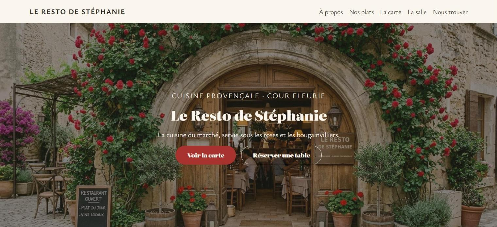
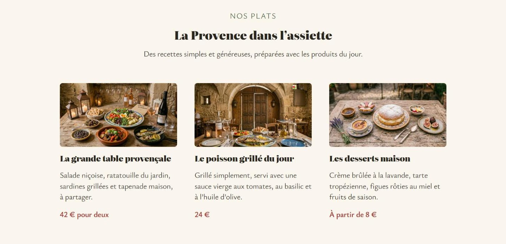
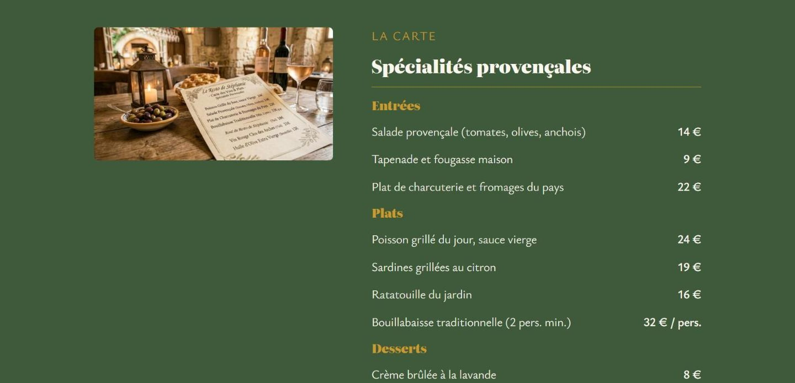
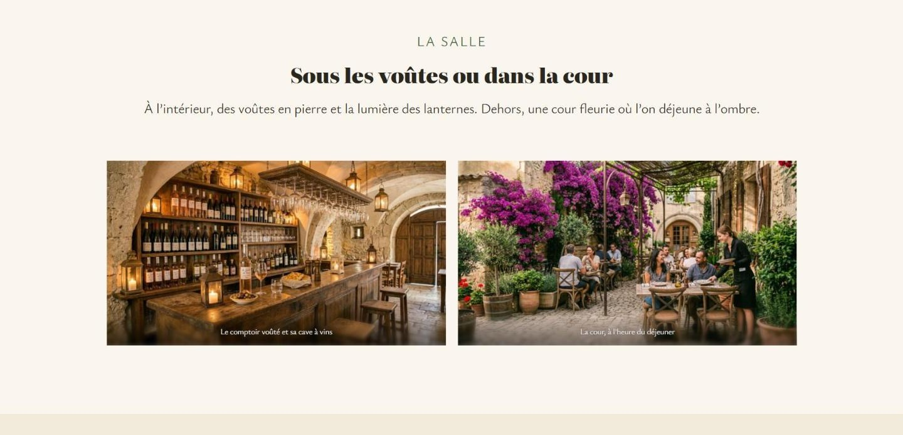
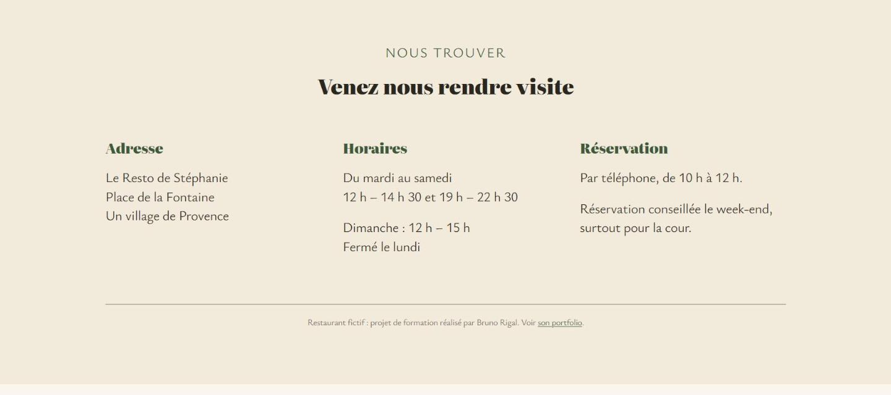
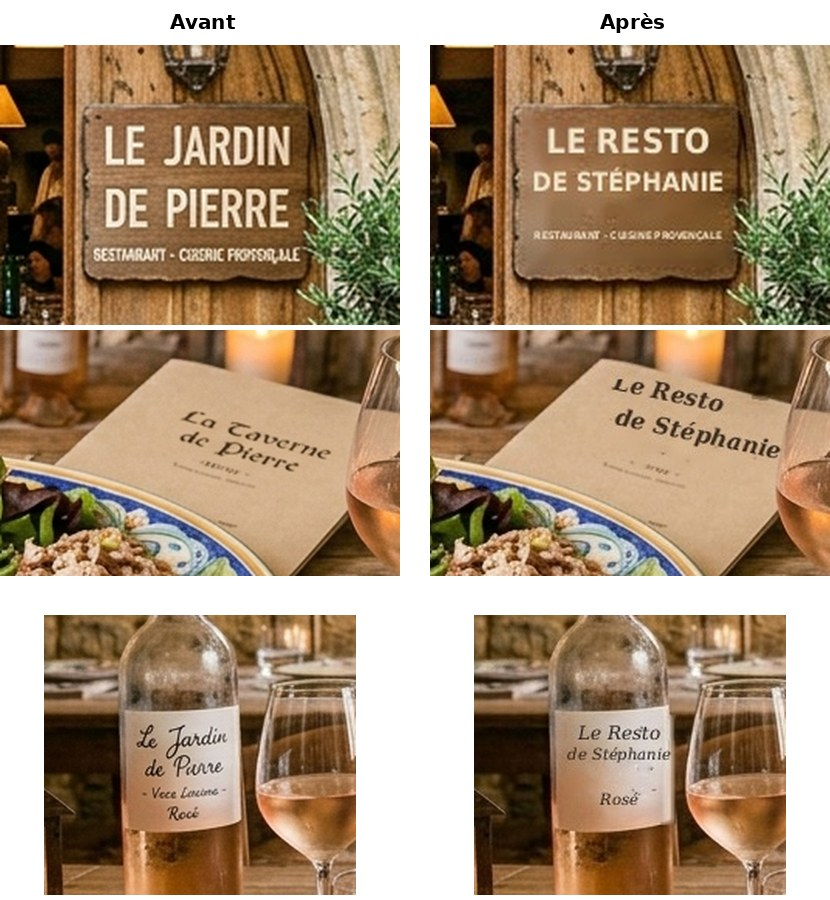
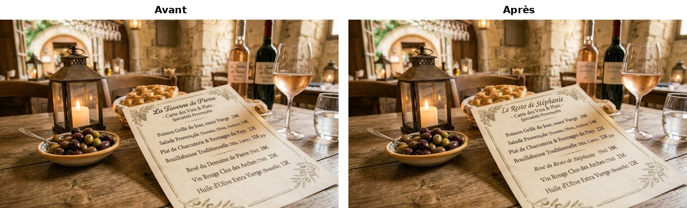

# Le Resto de Stéphanie

Site vitrine d'un restaurant provençal **fictif**, créé en **WordPress pur** et hébergé chez moi, sur un vieux PC portable transformé en serveur Linux.

**Site en ligne : https://resto.bruno34.com**



## En bref

- **WordPress 7.1** (en français) avec le thème officiel **Twenty Twenty-Five** et l'éditeur de blocs.
- **Aucun code écrit à la main** : pas de thème enfant, pas de CSS personnalisé, pas de JavaScript. Tout est fait avec les blocs, les styles globaux et le menu de WordPress.
- Une seule extension : **Animations for Blocks**, pour faire apparaître les sections en douceur pendant le défilement. Elle se règle bloc par bloc dans l'éditeur.
- Hébergement **à la maison** : Linux Mint, Nginx, PHP-FPM 8.3 et MariaDB, relié à Internet par un **tunnel Cloudflare**. Aucun port n'est ouvert sur la box.

## La page

Une seule page, avec un menu qui descend vers chaque partie :

| Partie | Contenu |
|---|---|
| Accueil | grande photo de la porte aux roses, titre et deux boutons |
| À propos | photo de la cour et présentation du restaurant |
| Nos plats | trois plats avec photo, description et prix |
| La carte | entrées, plats, desserts, vins et formule du midi |
| La salle | galerie : le comptoir voûté et la cour à l'heure du déjeuner |
| Nous trouver | adresse, horaires et réservation |

| | |
|---|---|
|  |  |
|  |  |

## Le serveur

```
Visiteur ──HTTPS──▶ Cloudflare ──tunnel──▶ cloudflared ──▶ Nginx ──▶ PHP-FPM 8.3 ──▶ WordPress ──▶ MariaDB
                                           └──────────────── le PC à la maison ────────────────┘
```

- **Cloudflare** gère le domaine `bruno34.com` et le certificat HTTPS.
- Le **tunnel** part du serveur vers Cloudflare : pas de redirection de port, l'adresse IP de la maison n'est pas exposée.
- **Nginx** sert plusieurs sites sur la même machine, selon l'adresse demandée : ce site WordPress sur `resto.bruno34.com`, et mon blog d'Eros (Rust et WebAssembly) sur `eros.bruno34.com`.
- **MariaDB** : une base et un utilisateur dédiés au site, qui n'ont accès à rien d'autre.
- Le PC reste **allumé en permanence** : la mise en veille est désactivée et la fermeture du couvercle est ignorée.
- Pare-feu **ufw** : la connexion SSH n'est autorisée que depuis le réseau de la maison.
- J'ai tout installé moi-même en ligne de commande, en SSH depuis mon PC principal.

## Contenu du dépôt

```
config/
  nginx/resto-stephanie      le bloc serveur Nginx du site
  php/99-wordpress.ini       réglages PHP (taille des envois, mémoire)
  systemd/couvercle.conf     le portable ne se met pas en veille quand on ferme l'écran
wordpress/
  page-accueil.html          la page d'accueil en blocs, copie exacte de celle du site
  styles-globaux.json        couleurs, polices et tailles de texte (styles globaux du thème)
  menu-principal.html        le menu de navigation
  pied-de-page.html          le pied de page du thème, modifié
images/                      les 8 photos du site
captures/                    captures d'écran et retouches avant / après
```

Ne sont **pas** dans le dépôt : WordPress lui-même (il se télécharge sur [fr.wordpress.org](https://fr.wordpress.org)), le fichier `wp-config.php`, la base de données, et aucun mot de passe ni jeton.

## Refaire le site

1. Installer WordPress avec Nginx, PHP-FPM et MariaDB, en s'aidant des fichiers du dossier `config/`.
2. Garder le thème **Twenty Twenty-Five** et installer l'extension **Animations for Blocks**.
3. Envoyer les photos du dossier `images/` dans la médiathèque.
4. Dans **Apparence → Éditeur → Styles**, reprendre les couleurs et les polices de `styles-globaux.json`.
5. Créer une page « Accueil », passer l'éditeur en mode code (`Ctrl + Maj + Alt + M`) et coller le contenu de `page-accueil.html`. Remplacer ensuite les adresses des images par celles de votre médiathèque.
6. Choisir le modèle « Page sans titre », puis **Réglages → Lecture** : afficher cette page comme page d'accueil.
7. Créer le menu avec les liens de `menu-principal.html` (des ancres comme `/#la-carte`).

## Les couleurs

| Nom | Code | Utilisation |
|---|---|---|
| Pierre claire | `#FAF6EE` | fond principal |
| Brun noyer | `#2A2620` | texte |
| Ocre de Provence | `#C99A2E` | titres de la carte |
| Lin | `#E9DFCC` | petites notes |
| Vert lierre | `#3F5A3A` | fond de la carte, liens |
| Pierre grise | `#6E665A` | séparateurs |
| Crème | `#F2EADB` | fonds de sections |
| Rouge des roses | `#A8322D` | bouton principal, prix |

Polices : Literata pour les titres, Ysabeau Office pour le texte (fournies avec le thème).

## Les photos

Les photos ont été **générées par IA** (Gemini). L'IA avait écrit d'autres noms de restaurant sur l'enseigne, la carte et les étiquettes des bouteilles. Ces noms ont été effacés puis remplacés par « Le Resto de Stéphanie », avec un script Python (OpenCV et Pillow).





## Réalisation

- **Bruno Rigal** : le projet, les choix, l'installation du serveur en ligne de commande, le domaine et le tunnel Cloudflare, la validation de chaque étape.

## Avertissement

Ce restaurant n'existe pas. Stéphanie, l'adresse, les prix et les horaires sont inventés. C'est un projet de formation, visible dans mon portfolio : https://rigal34.github.io
